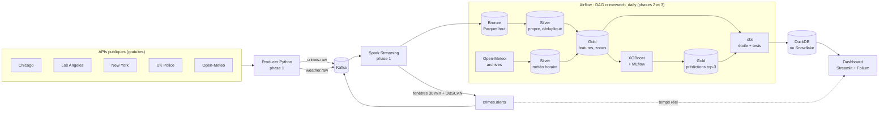

# CrimeWatch — Urban Crime Pattern Streaming & Prediction Platform

Plateforme Data Engineering qui récupère des données de criminalité urbaine
(Chicago, Los Angeles, New York, Londres) en quasi temps réel, détecte des zones
à risque avec **DBSCAN**, construit un Data Lake **Bronze / Silver / Gold** avec **Spark**,
l'enrichit avec la **météo historique**, prédit le **type de crime** avec **XGBoost**,
modélise un entrepôt en étoile avec **dbt** (DuckDB ou **Snowflake**) et restitue le tout dans un
dashboard **Streamlit + Folium**, le tout orchestré par **Airflow** et testé par **GitHub Actions**.

> **État du projet :** Phases 1 et 2 terminées et testées de bout en bout sur les vraies données.
> Phase 3 (dbt, dashboard, CI) codée et testée sur données synthétiques ; validation Docker et Snowflake à faire.
> Voir [`HANDOFF.md`](HANDOFF.md) et l'état d'avancement détaillé : [`docs/ETAT_AVANCEMENT.md`](docs/ETAT_AVANCEMENT.md) ([PDF](docs/ETAT_AVANCEMENT.pdf)).

## Architecture



| Couche | Contenu | Écrit par |
|---|---|---|
| **Bronze** | Messages Kafka bruts (doublons et démo compris) | `streaming/crime_stream_job.py` |
| **Silver** | Un crime par ligne, typé, dédupliqué, catégorie commune, `hour_known` | `batch/bronze_to_silver.py` |
| **Silver météo** | Météo heure par heure aux dates des crimes | `batch/weather_history.py` |
| **Gold** | `crime_features` (crime + météo + zone), `zone_hourly`, `zone_stats` | `batch/silver_to_gold.py` |
| **Modèle** | XGBoost : catégorie du crime, suivi dans MLflow | `ml/train_category.py` |
| **Prédictions** | Top-3 des catégories par zone, heure, semaine/week-end | `ml/predict_zones.py` |
| **Entrepôt** | Schéma en étoile + tables d'analyse, 50 tests de données | `crimewatch_dbt/` (dbt) |
| **Dashboard** | Carte, alertes live, prédictions, analyses | `dashboard/app.py` |

## Démarrage rapide

Prérequis : **Docker Desktop** (8 Go de RAM conseillés), **Python 3.11+**, **VS Code**.

```bash
# 1. Configuration
cp .env.example .env            # Windows : copy .env.example .env
python scripts/generate_synthetic_sample.py

# 2. Streaming : Kafka + Spark (attendre "3 queries démarrées")
docker compose up -d --build spark-streaming kafka-ui
docker compose logs -f spark-streaming

# 3. Producer (mode choisi dans .env : api ou replay)
docker compose up -d --build producer

# 4. Batch : Airflow (premier build : 5 à 15 min)
docker compose up -d --build airflow

# 5. Dashboard (après un premier passage du DAG)
docker compose up -d --build dashboard
```

| Interface | Adresse |
|---|---|
| Kafka UI | http://localhost:8080 (topics `crimes.raw`, `weather.raw`, `crimes.alerts`) |
| Spark UI | http://localhost:4040 |
| Airflow | http://localhost:8081 — `admin` / `admin` (mot de passe de développement) |
| MLflow | `mlflow ui --backend-store-uri sqlite:///mlflow.db` puis http://localhost:5000 |
| Dashboard | http://localhost:8501 |
| Documentation dbt | `cd crimewatch_dbt` puis `dbt docs generate` et `dbt docs serve --port 8090` |

**Lancer le pipeline batch :** dans Airflow, activer le DAG `crimewatch_daily`, puis ▶️ *Trigger DAG*.
Il enchaîne :

```
bronze_to_silver → check_silver → weather_history → silver_to_gold → check_gold
  → train_category → predict_zones → load_snowflake → dbt_build
```

Il tourne aussi tout seul chaque jour à 06:00 UTC.
⚠️ Ne pas cliquer *Clear* sur une tâche **en cours** : Airflow l'arrête (SIGTERM).

**Pour une démo qui montre des alertes tout de suite**, mets `PRODUCER_MODE=replay`
dans `.env`, puis `docker compose up -d producer` : 440 crimes sont rejoués en ~45 s,
et DBSCAN trouve 3 hotspots par ville en ~1 minute.
Les alertes : `docker compose logs spark-streaming | Select-String "ALERTE"` (PowerShell).

## Travailler dans VS Code (sans Docker pour le producer)

```bash
python -m venv .venv
# Windows : .venv\Scripts\activate     Mac/Linux : source .venv/bin/activate
pip install -r requirements-dev.txt

pytest                                       # 33 tests, sans internet ni Kafka
python -m producer.main --once --dry-run     # tester le producer sans Kafka
python -m ml.train_category                  # entraîner le modèle (Gold doit exister)

pip install -r crimewatch_dbt/requirements.txt -r dashboard/requirements.txt
cd crimewatch_dbt && dbt build && cd ..      # entrepôt DuckDB + tests de données
streamlit run dashboard/app.py               # http://localhost:8501
```

Tout essayer **sans Docker ni vraies données** (Gold synthétique) : section 11 de
[`docs/GUIDE_PHASE3.md`](docs/GUIDE_PHASE3.md).

Des configurations prêtes sont dans le menu **Exécuter et déboguer** (Ctrl+Shift+D).

## Résultats (données réelles, novembre 2026)

| | |
|---|---|
| Crimes dans Silver | **176 627** (Chicago 13 565 · LA 12 700 · New York 146 585 · Londres 3 777) |
| Doublons supprimés | ~25 000 (redémarrages du producer) |
| Crimes sans catégorie (`other`) | 15–24 % → **3–9 %** après les catégories v2 |
| Crimes avec météo | **100 %** (96,6 % à l'heure près, le reste à la journée) |
| Zones de ~500 m | 7 652 · n°1 : Times Square, le Loop (Chicago), Soho (Londres), Downtown LA |
| Modèle catégorie (16 classes) | accuracy **0,313** (référence 0,299) · top-3 **0,620** (référence 0,581) |

## Structure du projet

```
.
├── common/                  Code partagé
│   ├── config.py            Toute la configuration (villes, topics, URLs)
│   └── schemas.py           Le format commun des messages + 16 catégories
├── producer/                Phase 1 — APIs -> Kafka
│   ├── main.py              Point d'entrée (boucle, options)
│   ├── sources/             Une source par ville + météo
│   ├── kafka_client.py      Envoi vers Kafka (ou affichage en --dry-run)
│   ├── checkpoint.py        "Marque-page" : ne pas renvoyer 2 fois le même crime
│   ├── replay.py            Rejouer un fichier pour la démo
│   └── http_client.py       Appels HTTP avec réessais automatiques
├── streaming/               Phase 1 — Spark Streaming
│   ├── crime_stream_job.py  Le job Spark (Bronze + fenêtres + alertes)
│   └── clustering.py        DBSCAN en Python pur (testable sans Spark)
├── batch/                   Phase 2 — Data Lake
│   ├── bronze_to_silver.py  Parsing, dédup, catégories, hour_known
│   ├── weather_history.py   Météo historique (Open-Meteo archives)
│   ├── silver_to_gold.py    Features, zones, météo au moment du crime
│   └── quality_checks.py    Contrôles qualité entre les étapes Airflow
├── ml/                      Phase 2 — Machine Learning
│   └── train_category.py    XGBoost + MLflow (split temporel, baselines)
│   └── predict_zones.py     Phase 3 — top-3 prédit par zone / heure (pour le dashboard)
├── crimewatch_dbt/          Phase 3 — dbt : sources, staging, étoile, tests (DuckDB / Snowflake)
├── warehouse/               Phase 3 — load_snowflake.py (Gold -> Snowflake RAW)
├── dashboard/               Phase 3 — Streamlit + Folium (app.py, data.py)
├── .github/workflows/       Phase 3 — CI : pytest + pipeline dbt sur données synthétiques
├── airflow/dags/            Phase 2 — crimewatch_daily.py (le DAG)
├── scripts/                 Petits outils (lire un topic, générer des données de test)
├── tests/                   Tests pytest (sans internet, sans Kafka, sans Spark)
├── docker/                  Dockerfiles (producer, spark, airflow)
├── data/                    sample/ (échantillons), lake/ (Bronze/Silver/Gold), checkpoints/
├── docs/
│   ├── GUIDE_PHASE1.md      Explication simple du code de la phase 1
│   ├── GUIDE_PHASE3.md      Explication simple de la phase 3 (dbt, dashboard, CI)

│   └── CONTRAT_DONNEES.md   Format exact des messages et des tables
├── docker-compose.yml
└── HANDOFF.md               Passage de relais entre les membres de l'équipe
````

## État à la passation — 7 novembre 2026

| Sem. | Lot | Stack | État |
|---|---|---|---|
| S1 | Ingestion temps réel, producer multi-villes | Kafka | ✅ Livré |
| S2 | Traitement en flux et clustering | Spark Streaming, DBSCAN | ✅ Livré |
| S3 | Data Lake Silver/Gold, météo historique, orchestration | Spark, Airflow | ✅ Livré |
| S4 | Modèle de prédiction et suivi d'expériences | XGBoost, MLflow | ✅ Livré |
| S5 | Entrepôt et transformations | dbt, DuckDB, Snowflake | 🟡 Codé, testé (CI) ; Snowflake à brancher |
| S6 | Restitution et intégration continue | Streamlit, Folium, GitHub Actions | 🟡 Codé, testé (CI) ; validation Docker à faire |

**Phases 1 et 2 terminées** (S1–S4). **Phase 3 codée** (S5–S6) : dbt, prédictions, dashboard et CI
fonctionnent sur données synthétiques ; restent la validation dans Docker sur les vraies données
et le branchement de Snowflake. Le détail de ce qui est en place, des choix techniques,
des problèmes rencontrés et des points de vigilance figure dans `HANDOFF.md`.

## Sources de données

| Source | Dataset | Mise à jour |
|---|---|---|
| Chicago Data Portal | `ijzp-q8t2` | Quotidienne (~7 jours de retard) |
| LA Open Data | `k7nn-b2ep` (LAPD NIBRS, coordonnées `hndrdth_lat/lon`) | ~Toutes les 2 semaines |
| NYC Open Data | `5uac-w243` (NYPD YTD) | Trimestrielle |
| UK Police API | `crimes-street` (Londres centre) | Mensuelle |
| Open-Meteo | `forecast?current=...` (météo actuelle, producer) | Chaque appel |
| Open-Meteo Archive | `archive-api.open-meteo.com/v1/archive` (météo horaire passée) | ~5 jours de retard |

## Équipe

Mohamed Benheddane (phase 1) · Mustapha Hamdaoui Alaoui (phase 2) · Yassir Drissi (phase 3) — EMSI Rabat

