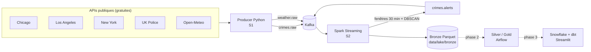

# CrimeWatch — Urban Crime Pattern Streaming & Prediction Platform

Plateforme Data Engineering qui récupère des données de criminalité urbaine
(Chicago, Los Angeles, New York, Londres) en quasi temps réel, détecte des zones
à risque avec **DBSCAN**, et (phases suivantes) prédit le type et l'heure des
incidents avec **XGBoost**.

> **État du projet :** Phase 1 (S1 + S2) terminée — ingestion Kafka + Spark Streaming + DBSCAN + Bronze,
> testée de bout en bout. Voir [`HANDOFF.md`](HANDOFF.md) pour la suite.

## Architecture



## Démarrage rapide

Prérequis : **Docker Desktop**, **Python 3.11 ou 3.12**, **VS Code**.

```bash
# 1. Configuration
cp .env.example .env            # Windows : copy .env.example .env
python scripts/generate_synthetic_sample.py

# 2. Lancer Kafka + Spark (attendre "3 queries démarrées")
docker compose up -d --build spark-streaming kafka-ui
docker compose logs -f spark-streaming

# 3. Lancer le producer (mode choisi dans .env : api ou replay)
docker compose up -d --build producer
```

- Kafka UI : http://localhost:8080 (topics `crimes.raw`, `weather.raw`, `crimes.alerts`)
- Spark UI : http://localhost:4040

**Pour une démo qui montre des alertes tout de suite**, mets `PRODUCER_MODE=replay`
dans `.env`, puis `docker compose up -d producer` : 440 crimes sont rejoués en ~45 s,
et DBSCAN trouve 3 hotspots par ville en ~1 minute.
Les alertes : `docker compose logs spark-streaming | Select-String "ALERTE"` (PowerShell).

## Travailler dans VS Code (sans Docker pour le producer)

```bash
python -m venv .venv
# Windows : .venv\Scripts\activate     Mac/Linux : source .venv/bin/activate
pip install -r requirements-dev.txt

pytest                                       # lancer les tests (16 tests)
python -m producer.main --once --dry-run     # tester le producer sans Kafka
```

Des configurations prêtes sont dans le menu **Exécuter et déboguer** (Ctrl+Shift+D).

## Structure du projet

```
.
├── common/                  Code partagé
│   ├── config.py            Toute la configuration (villes, topics, URLs)
│   └── schemas.py           Le format commun des messages + catégories
├── producer/                S1 — APIs -> Kafka
│   ├── main.py              Point d'entrée (boucle, options)
│   ├── sources/             Une source par ville + météo
│   ├── kafka_client.py      Envoi vers Kafka (ou affichage en --dry-run)
│   ├── checkpoint.py        "Marque-page" : ne pas renvoyer 2 fois le même crime
│   ├── replay.py            Rejouer un fichier pour la démo
│   └── http_client.py       Appels HTTP avec réessais automatiques
├── streaming/               S2 — Spark Streaming
│   ├── crime_stream_job.py  Le job Spark (Bronze + fenêtres + alertes)
│   └── clustering.py        DBSCAN en Python pur (testable sans Spark)
├── scripts/                 Petits outils (lire un topic, générer des données de test)
├── tests/                   Tests pytest (sans internet, sans Kafka)
├── docker/                  Dockerfiles
├── data/                    sample/ (échantillons), lake/ (Bronze), checkpoints/
├── docs/
│   ├── GUIDE_PHASE1.md      Explication simple de tout le code
│   └── CONTRAT_DONNEES.md   Format exact des messages et des tables
├── docker-compose.yml
└── HANDOFF.md               Passage de relais entre les membres de l'équipe
```

## Plan (6 semaines)

| Sem. | Objectif | État |
|---|---|---|
| S1 | Ingestion Kafka (producer multi-villes) | ✅ Phase 1 |
| S2 | Spark Streaming + DBSCAN temps réel | ✅ Phase 1 |
| S3 | Data Lake Silver/Gold + Airflow | ⏳ Phase 2 |
| S4 | ML XGBoost + MLflow | ⏳ Phase 2 |
| S5 | Snowflake + dbt | ⏳ Phase 3 |
| S6 | Dashboard Streamlit + CI | ⏳ Phase 3 |

## Sources de données

| Source | Dataset | Mise à jour |
|---|---|---|
| Chicago Data Portal | `ijzp-q8t2` | Quotidienne (~7 jours de retard) |
| LA Open Data | `k7nn-b2ep` (LAPD NIBRS, coordonnées `hndrdth_lat/lon`) | ~Toutes les 2 semaines |
| NYC Open Data | `5uac-w243` (NYPD YTD) | Trimestrielle |
| UK Police API | `crimes-street` (Londres centre) | Mensuelle |
| Open-Meteo | `forecast?current=...` | Chaque appel |
