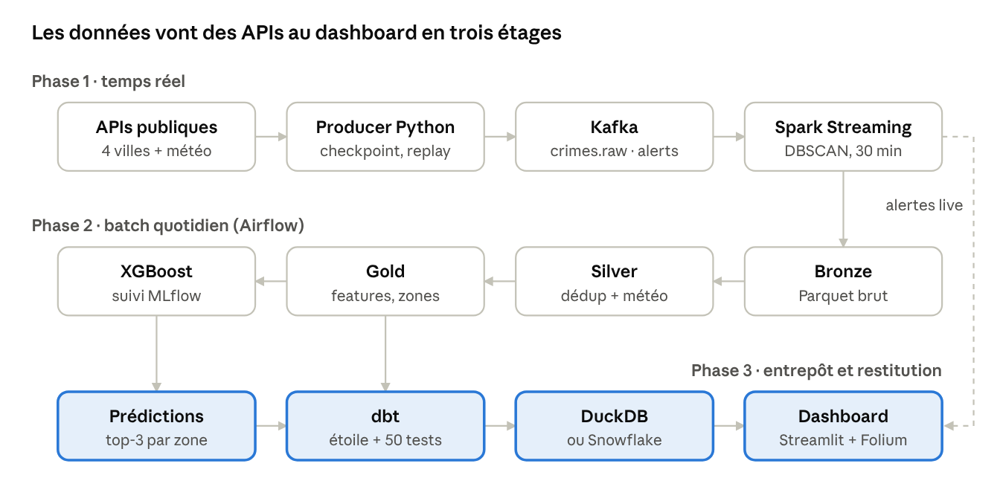

# CrimeWatch — État d'avancement

*Au 8 novembre 2026 · Yassir Drissi* · Version PDF : [`ETAT_AVANCEMENT.pdf`](ETAT_AVANCEMENT.pdf)

Les phases 1 et 2 (S1 à S4) sont livrées et testées sur les vraies données. La phase 3 (S5-S6 : dbt, dashboard, CI) est codée et testée sur des données synthétiques. Restent la validation Docker sur les vraies données, le branchement Snowflake et la démo.

## Vue d'ensemble

Quatre semaines sur six sont livrées et validées sur les vraies données. Les deux dernières sont codées et passent tous leurs tests, mais n'ont pas encore tourné dans Docker sur les vraies données.

| Sem. | Lot | Stack | Responsable | État |
| --- | --- | --- | --- | --- |
| S1 | Ingestion temps réel multi-villes | Kafka, Python | Mohamed Benheddane | Livré, testé le 05/11 |
| S2 | Traitement en flux et clustering | Spark Streaming, DBSCAN | Mohamed Benheddane | Livré, testé le 05/11 |
| S3 | Data Lake Silver/Gold, météo, orchestration | Spark, Airflow | Mustapha Hamdaoui Alaoui | Livré, DAG vert le 07/11 |
| S4 | Modèle de prédiction et suivi | XGBoost, MLflow | Mustapha Hamdaoui Alaoui | Livré le 07/11 |
| S5 | Entrepôt et transformations | dbt, DuckDB, Snowflake | Yassir Drissi | Codé et testé (données synthétiques) ; Snowflake à brancher |
| S6 | Restitution et intégration continue | Streamlit, Folium, GitHub Actions | Yassir Drissi | Codé et testé (données synthétiques) ; Docker à valider |

## Architecture

Les crimes entrent par Kafka (phase 1). Airflow les nettoie et les enrichit chaque nuit (phase 2). dbt les range ensuite et le dashboard les affiche (phase 3, en couleur). Les alertes DBSCAN vont directement au dashboard.

## Phase 1 (S1-S2) — Ingestion et streaming

Un producer Python récupère les crimes de 4 villes et la météo, puis les pousse dans Kafka. Spark Streaming détecte les hotspots en direct avec DBSCAN. Le pipeline a été testé de bout en bout le 05/11/2026.

**Livrables**

- `docker-compose.yml` : Kafka (KRaft), Kafka UI, producer, Spark
- 3 topics : `crimes.raw`, `weather.raw`, `crimes.alerts`
- Producer multi-villes (Chicago, Los Angeles, New York, Londres) + météo Open-Meteo, avec checkpoint (pas de doublon après redémarrage)
- Format commun des messages + catégories communes (`docs/CONTRAT_DONNEES.md`)
- Mode `replay` + échantillon synthétique pour la démo
- Job Spark Streaming : fenêtres de 30 min, DBSCAN, alertes vers `crimes.alerts`, Bronze en Parquet

**Résultats du test réel (05/11/2026)**

| Ville | Lignes reçues | Valides |
| --- | --- | --- |
| Londres | 3 777 | 3 777 |
| Chicago | 2 000 | 1 996 |
| Los Angeles | 2 000 | 1 998 |
| New York | 2 000 | 2 000 |

En démo, DBSCAN retrouve les 3 hotspots placés dans chaque ville (25, 15 et 10 crimes) et ignore les crimes isolés.

**Problèmes résolus**

- Los Angeles : 0 crime valide → nouveaux noms de colonnes de coordonnées (`hndrdth_lat/lon`).
- Alerte géante (1 803 crimes sur 12,78 km) due à l'effet de chaîne de DBSCAN → rayon maximal d'un hotspot fixé à 1 km.
- Fausses alertes du replay en boucle → le replay joue le fichier une seule fois.

## Phase 2 (S3-S4) — Data Lake, météo, ML, Airflow

Le batch quotidien transforme Bronze en Silver puis en Gold et y joint la météo historique. Il entraîne ensuite un XGBoost qui trouve la bonne catégorie dans son top-3 62 % du temps. Le DAG Airflow a été testé de bout en bout le 07/11/2026 (6 tâches vertes).

**Livrables**

- Silver : parsing, déduplication sur `event_id`, retrait des données de démo, colonne `hour_known`
- Catégories v2 : 16 catégories communes, part de `other` ramenée de 15-24 % à 3-9 %
- Météo historique heure par heure (archives Open-Meteo), jointe à 100 % des crimes
- Gold : `crime_features`, `zone_hourly`, `zone_stats` (grille de zones de ~500 m)
- XGBoost + MLflow, split temporel, 2 baselines, historique des zones sans fuite de données
- Contrôles qualité entre les étapes, DAG `crimewatch_daily` (Airflow 2.10 + Postgres)

**Données (07/11/2026)** : 201 785 crimes en Bronze → 176 627 en Silver (~25 000 doublons retirés). Par ville : New York 146 585, Chicago 13 565, Los Angeles 12 700, Londres 3 777. Le tout couvre 7 652 zones.

**Modèle « catégorie du crime »** (16 classes, test = les 20 % derniers jours de chaque ville)

| Run MLflow | Accuracy | Macro-F1 | Top-3 |
| --- | --- | --- | --- |
| Référence : catégorie la plus fréquente de la zone | 0,299 | 0,127 | 0,581 |
| `xgb_v1` (sans historique des zones) | 0,297 | 0,097 | 0,608 |
| **`xgb_v2_zone_history` (retenu)** | **0,313** | **0,129** | **0,620** |
| `xgb_v2_zone_history_balanced` | 0,200 | 0,149 | 0,425 |

Le lieu et la nuit comptent, la météo très peu. L'usage réaliste est le top-3 : « dans cette zone, ce soir, attendez-vous surtout à ces 3 types de crimes ».

## Phase 3 (S5-S6) — Entrepôt, dashboard, CI

Tous les composants sont codés et passent leurs tests sur un Gold synthétique, sur deux machines (cloud et PC de Yassir). Les images Docker et Snowflake n'ont pas encore tourné.

| Composant | Fichiers | Ce qu'il fait | Vérifié |
| --- | --- | --- | --- |
| Projet dbt | `crimewatch_dbt/` | Sources (Parquet) → 5 vues staging → 12 tables marts ; 3 seeds ; 50 tests | `dbt build` vert (70/70) |
| Schéma en étoile | `models/marts/` | `fact_crime` + `dim_city`, `dim_zone`, `dim_category`, `dim_date`, `dim_hour` ; `fact_zone_hourly` | Tests de clés et de relations verts |
| Tables d'analyse | `models/marts/mart_*` | Comparaison des villes, évolution, profil horaire, effet météo, prédictions | Contrôlées dans DuckDB et le dashboard |
| DuckDB / Snowflake | `profiles.yml`, `warehouse/load_snowflake.py` | Même SQL pour les deux bases ; chargement Gold → Snowflake `RAW` | DuckDB oui ; Snowflake non (pas de compte) |
| Prédictions | `ml/predict_zones.py` | Top-3 des catégories par zone × heure × semaine/week-end, depuis le dernier run MLflow | Tests unitaires + run complet |
| Métriques ML par ville | `ml/train_category.py` | `accuracy_<ville>`, `top3_accuracy_<ville>` dans MLflow | Run complet |
| Airflow | `airflow/dags/crimewatch_daily.py` | 9 tâches : + `predict_zones`, `load_snowflake`, `dbt_build` | Syntaxe ; pas encore lancé dans Docker |
| Dashboard | `dashboard/` | Carte heatmap, alertes Kafka live, prédictions top-3, analyses | Lancé sur le PC de Yassir (données synthétiques) |
| CI | `.github/workflows/ci.yml` | `pytest` + pipeline de bout en bout (Gold synthétique → modèle → prédictions → `dbt build`) | Reproduit en local ; pas encore lancée sur GitHub |
| Gold de test | `scripts/generate_gold_fixture.py` | Petit Gold inventé, mêmes colonnes et partitions que Spark | Utilisé par la CI |
| Documentation | `docs/GUIDE_PHASE3.md`, `HANDOFF.md`, `README.md`, `docs/CONTRAT_DONNEES.md` | Explication du code, passation, contrat des tables | — |

**Choix notable** : `mart_weather_impact` compte les heures de chaque condition météo et compare aux crimes attendus à la même heure de la journée (`index_vs_same_hour`). Sans cela, « il fait chaud l'après-midi » se confondrait avec « il y a plus de crimes l'après-midi ».

## Tests et qualité

Le projet compte 33 tests Python et 50 tests de données dbt, tous verts le 08/11/2026.

| Niveau | Quoi | Nombre | Où |
| --- | --- | --- | --- |
| Tests unitaires | Sources des villes, catégories, DBSCAN, replay, météo, contrôles qualité, prédictions, cohérence seeds dbt / code | 33 | `tests/` (pytest) |
| Contrôles qualité batch | Doublons, valeurs vides, crimes hors de leur ville, catégories inconnues, météo manquante < 5 % | 2 étapes | `batch/quality_checks.py` (Airflow) |
| Tests de données | `unique`, `not_null`, `relationships`, `accepted_values` + 3 tests sur mesure (zone_hourly = fact, crime dans sa zone, top-3 cohérent) | 50 | `crimewatch_dbt/` |
| CI | Job `tests` (pytest) + job `dbt` (pipeline de bout en bout sur données synthétiques) | 2 jobs | `.github/workflows/ci.yml` |

## Livrables du cahier des charges

Six livrables GitHub sur neuf sont en place. Les trois autres attendent la validation Docker ou la démo.

| Livrable | État |
| --- | --- |
| `docker-compose.yml` : Kafka, Spark, Airflow, Postgres en une commande | Livré (+ dashboard ajouté en phase 3, image à valider) |
| Producer Python multi-sources | Livré |
| Job PySpark Streaming + DBSCAN temps réel | Livré |
| Pipeline ML XGBoost tracké dans MLflow | Livré (+ prédictions par zone, métriques par ville) |
| Projet dbt : staging, marts, tests, lineage | Livré (DuckDB) ; Snowflake à brancher |
| DAGs Airflow documentés | Livré : 1 DAG quotidien de 9 tâches |
| Dashboard Streamlit + Folium (heatmap live + prédictions) | Codé, à valider sur vraies données |
| Badge CI vert GitHub Actions | Workflow prêt ; badge après le premier passage sur GitHub |
| README avec capture de la heatmap + démo vidéo 2 min | README à jour ; capture et vidéo à faire |

Le modèle « créneau horaire » prévu au cahier des charges n'est pas fait. Avec la météo à l'heure exacte comme feature, il verrait la réponse (fuite de données).

## Limites connues et risques

Le risque principal est que les images Docker de la phase 3 cassent au premier lancement : elles n'ont jamais été construites.

- **Pas de vrai temps réel** : les APIs ont du retard (Chicago ~7 jours, LA ~2 semaines, NYC ~3 mois, Londres ~1 mois). Pour la démo des alertes, utiliser `PRODUCER_MODE=replay`.
- **New York pèse 83 % des données** : le modèle est surtout entraîné sur NYC (d'où les métriques par ville ajoutées).
- **Londres sans heure** : pas de prédiction, ni d'analyse horaire ou météo ; la ville reste sur la carte et dans la comparaison.
- **Images Docker phase 3 non testées** (Airflow avec dbt, dashboard).
- **Snowflake non testé** : pas de compte ; l'essai gratuit dure 30 jours, à ouvrir près de la soutenance.
- **DuckDB = un fichier** : un seul programme peut l'écrire ; le dashboard l'ouvre en lecture seule et le referme après chaque requête.
- **Prédictions = scénarios** (mercredi / samedi, météo habituelle, sans pluie), pas une prévision du jour.
- **Mots de passe de développement** (`admin/admin`, Postgres `airflow/airflow`) à changer hors du PC.

## Reste à faire

- [ ] Pousser la branche `phase3-dbt` et ouvrir une Pull Request (relecture par Mohamed et Mustapha)
- [ ] Vérifier que la CI passe au vert sur GitHub, ajouter le badge au README
- [ ] Construire les images Docker (Airflow, dashboard) et lancer le DAG complet sur les vraies données
- [ ] Ouvrir l'essai Snowflake, remplir `.env`, `DBT_TARGET=snowflake`, relancer le DAG
- [ ] Captures d'écran (heatmap, lineage dbt, Airflow) dans le README
- [ ] Vidéo de démo de 2 minutes
- [ ] (Optionnel) Modèle « créneau horaire » sans fuite de données

## Historique

| Date | Étape |
| --- | --- |
| 08/11/2026 | Phase 3 codée : dbt, prédictions, dashboard, CI ; dashboard lancé sur données synthétiques |
| 07/11/2026 | Phase 2 terminée : DAG Airflow vert de bout en bout, modèle `xgb_v2_zone_history` retenu |
| 05/11/2026 | Phase 1 terminée : pipeline Kafka → Spark → alertes testé sur les 4 villes |
